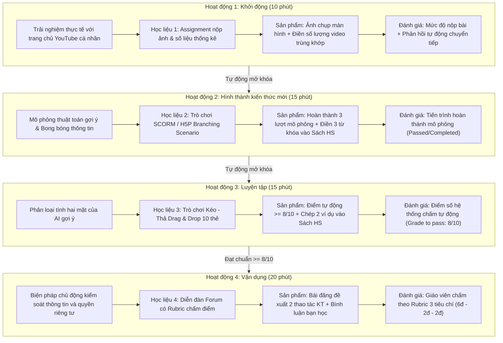

# PHẦN 2. THIẾT KẾ – PHÁT TRIỂN – TRIỂN KHAI BÀI HỌC THEO MÔ HÌNH ADDIE
### BÀI 4: KHÁM PHÁ MẶT TÍCH CỰC VÀ TIÊU CỰC CỦA MỘT SỐ TÍNH NĂNG AI (MỨC PHÂN TÍCH)
**HỌC PHẦN:** ĐÀO TẠO ĐIỆN TỬ VÀ ỨNG DỤNG (COMP1820)  
**MÔN HỌC:** TIN HỌC 6 — CHUYÊN ĐỀ TRÍ TUỆ NHÂN TẠO  

---

## 2.1. Giai đoạn Phân tích (Analysis)
* **Phân tích đối tượng người học**:
  - Học sinh lớp 6 (11–12 tuổi), sinh ra trong thời đại số (Digital natives), hàng ngày tiếp xúc nhiều với mạng xã hội và các nền tảng video (YouTube, TikTok, Facebook).
  - *Đặc điểm tâm lý:* Tò mò, thích khám phá qua trải nghiệm trực quan, dễ bị cuốn hút bởi nội dung giật gân, thiếu kiên nhẫn với các bài đọc dài thuần chữ.
  - *Rào cản nhận thức:* Hầu hết học sinh lầm tưởng rằng YouTube hay TikTok tự nhiên "thông minh" và biết hết mọi thứ, hoàn toàn chưa nhận thức được việc mình đang bị thuật toán AI thu thập dữ liệu hành vi và bị nhốt trong "bong bóng thông tin".
* **Phân tích bối cảnh và điều kiện dạy học**:
  - Hình thức dạy học: E-learning 100% (Tiết học trực tuyến trên hệ thống quản lý học tập LMS).
  - Học sinh học tập độc lập tại nhà qua máy tính để bàn, laptop hoặc điện thoại thông minh có kết nối Internet.
  - Không có giáo viên trực tiếp đứng lớp giảng giải từng phút $\rightarrow$ Các hoạt động học liệu số phải tự động hóa tối đa khâu giao việc, có phản hồi sửa sai tức thì và cơ chế mở khóa tuần tự để giữ chân người học.

---

## 2.2. Giai đoạn Thiết kế (Design)

### 1. Kịch bản sư phạm tổng thể (Ma trận liên kết 4 thành tố theo Công văn 5512)

---

## 2.3. Giai đoạn Phát triển học liệu (Hồ sơ thẻ What – Why – How cho 4 học liệu)

### THẺ HỌC LIỆU 1: BÀI TẬP NỘP FILE (ASSIGNMENT)
* **WHAT (Học liệu là gì?):** Module giao bài tập trực tuyến trên LMS tích hợp tải tệp ảnh (`.png`, `.jpg`) và nhập dữ liệu văn bản trực tuyến.
* **WHY (Tại sao sử dụng?):** Kích hoạt tri thức nền từ chính tài khoản YouTube cá nhân của học sinh; biến trải nghiệm thực tế đời thường thành ngữ liệu học tập sinh động; chứng thực trực quan mức độ theo dõi của AI.
* **HOW (Tổ chức thực hiện & Phản hồi):**
  - Học sinh đếm 10 video đầu tiên $\rightarrow$ Chụp ảnh màn hình $\rightarrow$ Nộp file lên hệ thống LMS và nhập số lượng, cảm nghĩ.
  - *Phản hồi tự động:* Hệ thống lập tức gửi tin nhắn động viên, gợi mở bí mật phía sau thuật toán gợi ý và tự động mở khóa Hoạt động 2.

### THẺ HỌC LIỆU 2: VIDEO TƯƠNG TÁC & TRÒ CHƠI MÔ PHỎNG (SCORM / H5P BRANCHING SCENARIO)
* **WHAT (Học liệu là gì?):** Học liệu Video tương tác 2 phần: xem video hoạt hình giải thích thuật toán mạng xã hội (~3 phút), sau đó trực tiếp tham gia trò chơi rẽ nhánh đóng vai "Kỹ sư điều khiển thuật toán AI VideoTube" để tối đa hóa thời gian giữ chân bạn Nam (12 tuổi).
* **WHY (Tại sao sử dụng?):**
  - Giúp học sinh nắm vững kiến thức nền tảng trước khi bước vào thực hành mô phỏng, tránh việc người học bị quá tải nhận thức hoặc bỡ ngỡ.
  - Vận dụng chuẩn H5P Interactive Video, kết hợp minh chứng khoa học *Australian Government (2023) - DP-REG Literature Summary* để làm rõ cơ chế **Bong bóng thông tin (Filter Bubbles)** và rủi ro **Mất kiểm soát dữ liệu cá nhân**.
* **HOW (Tổ chức thực hiện & Phản hồi):**
  - *Bước 1:* GV chuyển giao nhiệm vụ xem video hoạt hình và vượt qua thử thách mô phỏng cuối video.
  - *Bước 2:* HS xem video (~3 phút) $\rightarrow$ Tự động chuyển tiếp vào trò chơi mô phỏng 3 lượt lựa chọn video để giữ chân Nam.
  - *Bước 3:* Trực quan hóa qua "Quả cầu nhận thức" co hẹp và 3 đồng hồ đo chỉ số $\rightarrow$ Điền 4 từ khóa vào Sách học sinh.
  - *Bước 4:* LMS tự động ghi nhận điểm số SCORM 100/100 (Passed) và mở khóa Hoạt động 3.

### THẺ HỌC LIỆU 3: BÀI TẬP KÉO - THẢ (DRAG & DROP)
* **WHAT (Học liệu là gì?):** Trò chơi kéo thả phân loại 10 thẻ tình huống thực tế vào 2 cột: **Mặt tích cực (Ưu điểm)** và **Mặt hạn chế (Rủi ro)**, hỗ trợ cả chuột máy tính và chạm cảm ứng điện thoại.
* **WHY (Tại sao sử dụng?):** Đánh giá năng lực nhận diện và phân tích tính hai mặt của AI (YCCĐ 6.B1.1); tự động hóa khâu chấm điểm, cung cấp phản hồi tức thì cho học sinh thử và sửa sai an toàn.
* **HOW (Tổ chức thực hiện & Phản hồi):**
  - Kéo 10 thẻ $\rightarrow$ Bấm "Chấm điểm tự động".
  - *Thuật toán đánh giá:* Điểm số = Tổng số thẻ đúng / 10.
  - Nếu điểm $\ge 8/10$: Hiệu ứng chúc mừng, yêu cầu chọn 2 ví dụ tâm đắc ghi vào Sách học sinh và tự động mở khóa Hoạt động 4.
  - Nếu điểm $< 8/10$: Báo lỗi trực quan và yêu cầu bấm "Làm lại" để đạt chuẩn.

### THẺ HỌC LIỆU 4: DIỄN ĐÀN THẢO LUẬN (FORUM) KÈM RUBRIC CHẤM ĐIỂM
* **WHAT (Học liệu là gì?):** Diễn đàn học tập trực tuyến tích hợp ma trận Rubric chấm điểm định lượng 3 tiêu chí theo chuẩn Công văn 5512.
* **WHY (Tại sao sử dụng?):** Tạo môi trường tương tác xã hội trong lớp học E-learning; rèn luyện năng lực giải quyết vấn đề thực tiễn (đề xuất thao tác kỹ thuật phá vỡ bong bóng thông tin); phát triển phẩm chất trách nhiệm và đạo đức khi sử dụng AI.
* **HOW (Tổ chức thực hiện & Phản hồi):**
  - Học sinh lập dàn ý vào Sách học sinh $\rightarrow$ Đăng bài hoàn chỉnh lên Diễn đàn $\rightarrow$ Bình luận phản hồi bài của bạn học.
  - Giáo viên đánh giá bằng biểu mẫu Rubric trên LMS:
    * Tiêu chí 1: Tính khả thi của giải pháp (Tối đa 6.0 điểm).
    * Tiêu chí 2: Hiểu bản chất thuật toán (Tối đa 2.0 điểm).
    * Tiêu chí 3: Trình bày và Tương tác (Tối đa 2.0 điểm).

---

## 2.4. Giai đoạn Triển khai trên LMS (Implementation)
1. Cấu hình khóa học trên nền tảng LMS (Moodle / K12Online).
2. Kích hoạt tính năng **Completion Tracking** (Theo dõi hoàn thành) cho toàn bộ khóa học.
3. Thiết lập chuỗi **Restrict Access** (Hạn chế truy cập theo tiến trình) đảm bảo tính tuần tự sư phạm.
4. Kiểm thử giao diện và độ mượt mà trên nhiều thiết bị: Máy tính để bàn (Windows), Máy tính bảng (iPad), Điện thoại thông minh (Android/iOS).

---

## 2.5. Giai đoạn Đánh giá và cải tiến (Evaluation)
* **Đánh giá quá trình (Formative Assessment)**: Hệ thống ghi nhận tiến trình từng bước: nộp bài HĐ 1, vượt qua kịch bản mô phỏng HĐ 2, điểm số bài kéo thả HĐ 3.
* **Đánh giá tổng kết (Summative Assessment)**: Điểm số diễn đàn HĐ 4 căn cứ theo ma trận Rubric định lượng.
* **Kiểm tra chéo và đối chiếu liêm chính**: Giáo viên thu hồi Sách học sinh / Phiếu học tập ở buổi học trực tiếp trên lớp tiếp theo để đối chiếu với dữ liệu log trên hệ thống LMS.

