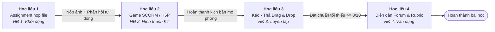

# Trọn Bộ Học Liệu Tin Học 6: Bài 4 - Khám Phá Mặt Tích Cực Và Tiêu Cực Của Một Số Tính Năng AI
> **Hình thức dạy học:** Dạy học trực tuyến 100% trên hệ thống quản lý học tập LMS (E-learning hoàn toàn - Thời lượng: 1 tiết 45 phút).  
> **Mức độ nhận thức:** Mức Phân tích (Analyze).  
> **Căn cứ thiết kế:** Kế hoạch bài dạy (KHBD) Tin học 6 Bài 4, Công văn số 5512/BGDĐT-GDTrH, Lý thuyết Học đa phương tiện (Clark & Mayer, 2011), Khung SECTIONS (Bates, 2019), Tài liệu chuyên môn *Australian Government (2023) - DP-REG Literature Summary* (Recommender Systems, Filter Bubbles, Privacy Risks).

---

## 🌐 TỔNG QUAN 4 CỤM HỌC LIỆU SỐ TRÊN HỆ THỐNG LMS

Tiết học được thiết kế thành **Chuỗi học tập tuần tự có điều kiện (Conditional / Linear Learning Path)** bám sát 4 hoạt động của tiến trình dạy học:

---

### 1. `hoc_lieu_1_assignment.html` (Hoạt động 1: Khởi động - 10 phút)
* **Loại công cụ LMS:** Bài tập nộp file (Assignment: File submission + Online text).
* **Nhiệm vụ học sinh:** Tự quan sát 10 video đầu tiên trên trang chủ YouTube cá nhân, đếm số video trùng khớp chủ đề vừa xem gần đây, chụp ảnh màn hình và nộp lên LMS kèm cảm nghĩ ngắn.
* **Cơ chế sư phạm:** Tự động gửi thông điệp phản hồi sư phạm (Automated Feedback) ngay sau khi nộp bài để tạo hứng thú và tự động mở khóa Hoạt động 2.

### 2. `hoc_lieu_2_game_mophong.html` (Hoạt động 2: Hình thành kiến thức - 15 phút)
* **Loại công cụ LMS:** Trò chơi mô phỏng tương tác (Gói SCORM 1.2 / H5P Branching Scenario).
* **Nhiệm vụ học sinh:** Đóng vai "Kỹ sư điều khiển Thuật toán AI VideoTube" với mục tiêu tối đa hóa thời gian giữ chân (Watch time / Retention) của người dùng ảo (bạn Nam - 12 tuổi).
* **Minh chứng khoa học:** Trực quan hóa hiện tượng **Bong bóng thông tin (Filter Bubbles)** và nguy cơ **Mất kiểm soát dữ liệu cá nhân** theo tài liệu chuyên môn của Chính phủ Úc (DP-REG 2023). Sau trò chơi, học sinh chốt 3 từ khóa cốt lõi (*Cá nhân hóa*, *Bong bóng thông tin*, *Quyền riêng tư*).

### 3. `hoc_lieu_3_gamification_keo_tha.html` (Hoạt động 3: Luyện tập - 15 phút)
* **Loại công cụ LMS:** Bài tập trò chơi hóa (Gamification) Kéo - Thả Drag & Drop chuẩn HTML5 (Hỗ trợ cả chuột máy tính và chạm cảm ứng điện thoại).
* **Nhiệm vụ học sinh:** Phân loại 10 thẻ tình huống thực tế vào 2 cột: **Mặt tích cực (Ưu điểm)** và **Mặt hạn chế (Rủi ro)**.
* **Tiêu chuẩn vượt qua (Grade to Pass):** Đạt tối thiểu **8/10 điểm (80%)**. Cho phép làm lại không giới hạn; tự động mở khóa Hoạt động 4 khi đạt chuẩn.

### 4. `hoc_lieu_4_dien_dan_rubric.html` (Hoạt động 4: Vận dụng - 20 phút)
* **Loại công cụ LMS:** Diễn đàn thảo luận (Forum) tích hợp Rubric chấm điểm định lượng (Whole Forum Grading).
* **Chủ đề thảo luận:** *"Làm sao để thoát khỏi bong bóng thông tin?"*
* **Nhiệm vụ học sinh:** Đề xuất ít nhất 02 thao tác kỹ thuật thực tế (xóa lịch sử, dùng tab ẩn danh, chủ động tìm từ khóa mới...), giải thích bản chất thuật toán và phản hồi bài viết của ít nhất 01 bạn trong lớp.
* **Ma trận Rubric 3 tiêu chí (Tổng 10 điểm):**
  1. *Tính khả thi của giải pháp:* 6.0 điểm
  2. *Hiểu bản chất thuật toán:* 2.0 điểm
  3. *Trình bày và Tương tác:* 2.0 điểm

---

## 📑 HỒ SƠ TÀI LIỆU VÀ CÔNG CỤ ĐỒNG HÀNH

1. **`BAO_CAO_A3.4_THIET_KE_PHAT_TRIEN_BAI_HOC_LMS.md`**: Báo cáo học thuật toàn diện theo quy chuẩn bài tập lớn A3.4 (Học phần COMP1820).
2. **`PHAN_1_CO_SO_THIET_KE_VA_KHAO_SAT_CONG_CU.md`**: Cơ sở lý luận giáo dục mở rộng (Học liệu vs Hoạt động học, 4 loại tri thức Anderson & Krathwohl, 12 nguyên lý Clark & Mayer, Khung SECTIONS).
3. **`PHAN_2_THIET_KE_PHAT_TRIEN_TRIEN_KHAI_ADDIE.md`**: Quy trình thiết kế ADDIE chi tiết cho Bài 4 (Hồ sơ What - Why - How của từng học liệu).
4. **`HOC_LIEU_LMS_BAI_4.md`**: Hướng dẫn giáo viên cấu hình chi tiết trên Moodle, Canvas, K12Online, vnEdu LMS.
5. **`sach_hoc_sinh_va_phieu_hoc_tap.html`**: Phiếu học tập / Sách học sinh đồng hành thiết kế chuẩn A4 có nút in (Print to PDF) để học sinh ghi chép làm minh chứng tự học khi đến lớp.
6. **`preview_hoc_lieu_bai_4.html`**: Trang xem trước liên hoàn trọn bộ 4 học liệu số.
7. **`index.html`**: Cổng trải nghiệm trung tâm (LMS Virtual Course Dashboard) với thiết kế hiện đại, responsive.

---

## 🚀 HƯỚNG DẪN MỞ VÀ TRẢI NGHIỆM TRỰC TIẾP
* **GitHub Pages Trực tuyến:** [https://toiyeutinhoc238-sudo.github.io/lms_bai_4/](https://toiyeutinhoc238-sudo.github.io/lms_bai_4/)
* **Chạy cục bộ:** Nhấp đúp mở file `index.html` trên trình duyệt web (Google Chrome, Microsoft Edge, Cốc Cốc) để trải nghiệm toàn bộ hệ thống lớp học trực tuyến.
* **Tích hợp LMS:** Giáo viên có thể nhúng trực tiếp các file `.html` vào hệ thống LMS (Moodle, Canvas, K12Online, vnEdu) thông qua thẻ `<iframe>` hoặc xuất thành gói chuẩn SCORM 1.2.

