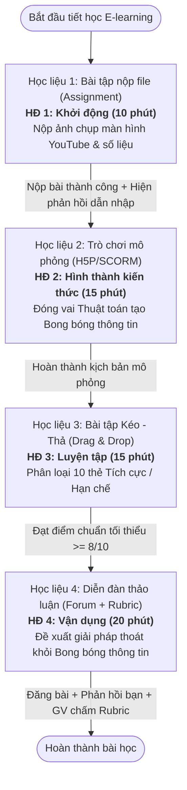
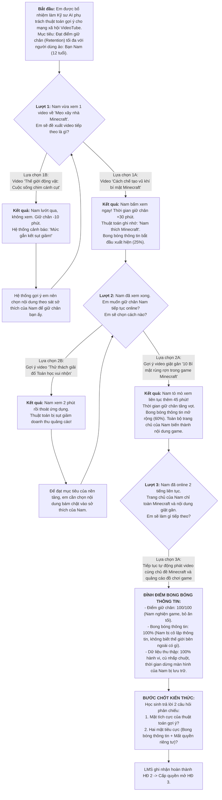

# THIẾT KẾ VÀ CẤU HÌNH HỌC LIỆU SỐ TRÊN HỆ THỐNG LMS
## BÀI 4: KHÁM PHÁ MẶT TÍCH CỰC VÀ TIÊU CỰC CỦA MỘT SỐ TÍNH NĂNG AI
**Môn học:** Tin học 6 — Chuyên đề Trí tuệ nhân tạo  
**Hình thức dạy học:** E-learning (Trực tuyến 100%) — Thời lượng: 1 tiết (45 - 50 phút)  
**Tài liệu tham chiếu:** Kế hoạch bài dạy (KHBD) Bài 4 & Tài liệu DP-REG (Australian Government, 2023)

---

## I. TỔNG QUAN CẤU TRÚC TIẾN TRÌNH TRÊN LMS

Khóa học được cấu hình thành một **Module học tập tuần tự (Linear / Conditional Learning Path)**. Học sinh phải hoàn thành hoạt động trước với các điều kiện đạt chuẩn thì hệ thống LMS mới tự động mở khóa hoạt động tiếp theo.

---

## II. CHI TIẾT 4 CỤM HỌC LIỆU SỐ TRÊN LMS

---

### HỌC LIỆU 1: BÀI TẬP NỘP FILE (ASSIGNMENT)
*Sử dụng cho Hoạt động 1: Khởi động (Trải nghiệm thực tế với hệ thống gợi ý - 10 phút)*

#### 1. Thông tin cấu hình hệ thống
- **Tên hoạt động trên LMS:** `[HĐ 1 - Khởi động] Trải nghiệm thực tế: Khám phá "Trang chủ YouTube của em"`
- **Loại hoạt động:** Assignment (Nộp bài tập)
- **Hình thức nộp bài:** File submission (Chấp nhận định dạng ảnh `.png`, `.jpg`, `.jpeg`) kết hợp Online text (Ô văn bản ghi chú ngắn).
- **Số tệp tối đa:** 01 tệp ảnh (dung lượng tối đa 10 MB).
- **Cài đặt điều kiện hoàn thành (Activity Completion):** Học sinh phải nộp bài tập (Student must submit to this activity to complete it).
- **Cài đặt hạn chế truy cập (Restrict Access):** Không có (mở sẵn cho học sinh khi vào bài).

#### 2. Nội dung hiển thị cho học sinh (Đề bài & Hướng dẫn)
> **Nhiệm vụ của em:**
> 1. Mở ứng dụng hoặc trang web **YouTube** trên điện thoại hoặc máy tính của em (đăng nhập tài khoản cá nhân em thường dùng).
> 2. Quan sát **10 video đầu tiên** hiển thị trên trang chủ (Home).
> 3. Hãy đếm xem có bao nhiêu video trùng khớp hoặc có liên quan trực tiếp đến các chủ đề em vừa tìm kiếm hoặc xem gần đây (ví dụ: chơi game, âm nhạc, review đồ ăn, khoa học...).
> 4. **Chụp ảnh màn hình (Screenshot)** trang chủ YouTube thể hiện các video đó.
> 5. Tải ảnh chụp lên bài nộp này.
> 6. Tại ô văn bản, hãy nhập câu trả lời theo mẫu:
>    - *Số video trùng khớp sở thích gần đây:* ... / 10 video.
>    - *Cảm nghĩ nhanh của em:* (Ví dụ: Em thấy YouTube rất hiểu em / Em thấy hơi bất ngờ vì vừa tìm xong là YouTube hiện ra ngay...).

#### 3. Phản hồi tự động của hệ thống (Automated Feedback Message)
*Ngay sau khi học sinh bấm "Nộp bài", hệ thống LMS sẽ tự động gửi thông báo phản hồi chuyển tiếp:*
> 🎉 **Chúc mừng em đã hoàn thành Hoạt động 1!**  
> Em có thấy YouTube dường như "đọc được suy nghĩ" của mình không? Đó chính là nhờ **Thuật toán gợi ý (Recommender System)** hoạt động dựa trên việc thu thập và phân tích lịch sử của em.  
> *Nhưng thuật toán này hoạt động như thế nào? Và nó có "chiêu trò" gì để giữ chân em?*  
> 👉 **Hoạt động 2 đã được mở khóa!** Hãy bấm nút tiếp theo để tham gia trò chơi mô phỏng thú vị ngay bây giờ nhé!

---

### HỌC LIỆU 2: TRÒ CHƠI MÔ PHỎNG TƯƠNG TÁC (SCORM / H5P BRANCHING SCENARIO)
*Sử dụng cho Hoạt động 2: Hình thành kiến thức mới (Mô phỏng thuật toán gợi ý - 15 phút)*

#### 1. Thông tin cấu hình hệ thống
- **Tên hoạt động trên LMS:** `[HĐ 2 - Khám phá] Trò chơi mô phỏng: "Em là Thuật toán Gợi ý"`
- **Công cụ tích hợp:** Gói SCORM 1.2 / H5P Branching Scenario (hoặc nhúng iFrame ứng dụng tương tác HTML5).
- **Cài đặt điều kiện mở khóa (Restrict Access):** Hoàn thành Hoạt động 1 (Activity 1 is marked complete).
- **Cài đặt điều kiện hoàn thành (Activity Completion):** Học sinh phải trải nghiệm hết kịch bản mô phỏng và trả lời câu hỏi chốt kiến thức (Passed / Completed status).

#### 2. Kịch bản phân nhánh chi tiết (Branching Scenario Flow)
- **Cơ sở khoa học (Minh chứng báo cáo):** Trích dẫn từ *Australian Government (2023) - DP-REG Literature Summary* (Mục 2.B trang 16: Tối ưu thời gian giữ chân - Maximizing time spent; Mục 2.B.1.2 trang 18: Buồng âm vang và bong bóng bộ lọc - Echo chambers and filter bubbles; Mục 2.B.2.3 trang 21: Mất kiểm soát dữ liệu cá nhân).

#### 3. Nội dung điền khuyết lý thuyết (Học sinh đối chiếu ghi chép vào sách)
Sau khi trải nghiệm trò chơi, học sinh rút ra 3 từ khóa cốt lõi:
1. **Cá nhân hóa (Personalization):** AI phân tích dữ liệu lịch sử để dự đoán và đưa ra video đúng sở thích cá nhân.
2. **Bong bóng thông tin (Filter Bubble):** Hiện tượng người dùng chỉ được tiếp cận với các thông tin cùng chiều với sở thích/quan điểm của mình, bị cô lập khỏi các góc nhìn đa dạng khác.
3. **Mất kiểm soát quyền riêng tư (Privacy Loss):** Nền tảng thu thập lượng dữ liệu ngày càng lớn về thói quen, hành vi cá nhân mà người dùng khó kiểm soát.

---

### HỌC LIỆU 3: BÀI TẬP KÉO - THẢ (DRAG & DROP)
*Sử dụng cho Hoạt động 3: Luyện tập (Phân loại tính hai mặt của AI - 15 phút)*

#### 1. Thông tin cấu hình hệ thống
- **Tên hoạt động trên LMS:** `[HĐ 3 - Luyện tập] Thử thách Phân loại: Mặt tích cực và Hạn chế của AI gợi ý`
- **Loại hoạt động:** Drag and Drop Matching Question / Interactive Content H5P.
- **Cài đặt điều kiện mở khóa (Restrict Access):** Đã hoàn thành Hoạt động 2.
- **Thang điểm:** 10 điểm (Mỗi thẻ đúng = 1 điểm).
- **Điểm chuẩn đạt yêu cầu (Grade to Pass):** **8/10 điểm (80%)**.
- **Số lần làm bài:** Không giới hạn (Học sinh được làm lại nhiều lần cho đến khi đạt từ 8 điểm trở lên).
- **Cài đặt điều kiện hoàn thành (Activity Completion):** Học sinh phải nhận được điểm số đạt chuẩn (Student must achieve a passing grade of at least 8/10).

#### 2. Ngân hàng 10 thẻ thông tin tình huống thực tế
Học sinh dùng chuột hoặc cảm ứng để kéo 10 thẻ vào 2 vùng thả tương ứng:

| STT | Thẻ thông tin tình huống thực tế | Phân loại chuẩn (Đáp án) | Giải thích ngắn gọn cho HS |
|:---:|:---|:---:|:---|
| **1** | Tự động đề xuất các bài hát phù hợp với tâm trạng và sở thích âm nhạc mà không mất công tìm kiếm. | **MẶT TÍCH CỰC** | Tiết kiệm thời gian, nâng cao trải nghiệm giải trí cá nhân. |
| **2** | Người dùng bị cuốn vào màn hình quá nhiều giờ do các video hấp dẫn liên tục tự động phát nối tiếp. | **MẶT HẠN CHẾ** | Gây nghiện số, lãng phí thời gian và ảnh hưởng sức khỏe. |
| **3** | Gợi ý các khóa học tiếng Anh, bài giảng trực tuyến phù hợp đúng với trình độ và nhu cầu học tập của em. | **MẶT TÍCH CỰC** | Hỗ trợ học tập hiệu quả, cá nhân hóa lộ trình giáo dục. |
| **4** | Tạo ra "Bong bóng thông tin", khiến người dùng chỉ nhìn thấy thông tin một chiều và thiếu cái nhìn đa chiều. | **MẶT HẠN CHẾ** | Hạn chế góc nhìn xã hội, củng cố định kiến sai lệch. |
| **5** | Nền tảng âm thầm thu thập toàn bộ lịch sử xem, vị trí và thời gian dừng màn hình để xây dựng hồ sơ cá nhân. | **MẶT HẠN CHẾ** | Rủi ro rò rỉ dữ liệu và xâm phạm quyền riêng tư. |
| **6** | Hỗ trợ người mua sắm trực tuyến nhanh chóng tìm được món hàng ưng ý với mức giá và mẫu mã phù hợp. | **MẶT TÍCH CỰC** | Tối ưu hóa tìm kiếm sản phẩm tiêu dùng hữu ích. |
| **7** | Dễ dẫn dắt người dùng đến các nội dung giật gân, tin giả (fake news) để câu lượt xem và tương tác. | **MẶT HẠN CHẾ** | Lan truyền thông tin sai lệch gây hoang mang dư luận. |
| **8** | Ứng dụng bản đồ gợi ý tuyến đường thông thoáng nhất dựa trên tình trạng ùn tắc giao thông thời gian thực. | **MẶT TÍCH CỰC** | Tận dụng dữ liệu lớn để giải quyết bài toán giao thông thực tế. |
| **9** | Quảng cáo một món đồ vừa nhắc tới liên tục xuất hiện "bám đuổi" trên mọi trang web em truy cập. | **MẶT HẠN CHẾ** | Cảm giác bị theo dõi, mất an toàn thông tin cá nhân. |
| **10** | Giúp người dùng nhanh chóng tiếp cận thông tin thời sự mới nhất mà bản thân đang quan tâm. | **MẶT TÍCH CỰC** | Cập nhật tri thức nhanh chóng và tiện lợi. |

#### 3. Thiết lập thông điệp phản hồi kết quả tự động
- **Trường hợp ĐẠT (Điểm từ 8 đến 10 điểm):**
  > 🌟 **Xuất sắc! Em đã hoàn thành thử thách với số điểm {score}/10!**  
  > Em đã nắm rất vững tính hai mặt của công nghệ AI gợi ý.  
  > 📌 **Nhiệm vụ tiếp theo:** Hãy chọn **02 ví dụ tâm đắc nhất** (1 tích cực, 1 hạn chế) ghi lại vào bảng trong Sách học sinh để làm minh chứng.  
  > 👉 **Hoạt động 4 (Diễn đàn thảo luận) đã mở khóa!** Hãy cùng vào tranh luận giải pháp nhé!
- **Trường hợp CHƯA ĐẠT (Dưới 8 điểm):**
  > ⚠️ **Em đạt {score}/10 điểm - Chưa đạt ngưỡng chuẩn (tối thiểu 8/10).**  
  > Có vẻ một số tình huống đã bị xếp nhầm giữa "Tích cực" và "Hạn chế". Hãy bấm nút **"Làm lại"** để thử thách lại và mở khóa chặng cuối cùng nhé!

---

### HỌC LIỆU 4: DIỄN ĐÀN THẢO LUẬN (FORUM) KÈM RUBRIC CHẤM ĐIỂM
*Sử dụng cho Hoạt động 4: Vận dụng (Biện pháp chủ động kiểm soát thông tin - 20 phút)*

#### 1. Thông tin cấu hình hệ thống
- **Tên hoạt động trên LMS:** `[HĐ 4 - Vận dụng] Diễn đàn: "Làm sao để thoát khỏi bong bóng thông tin?"`
- **Loại diễn đàn:** Standard forum for general use (Diễn đàn chuẩn thảo luận chung).
- **Cài đặt điều kiện mở khóa (Restrict Access):** Đã hoàn thành Hoạt động 3 với điểm số >= 8/10.
- **Phương thức chấm điểm (Grading method):** **Rubric (Tiêu chí định lượng)** tích hợp trực tiếp trên LMS.
- **Thang điểm tối đa:** 10 điểm.
- **Cài đặt điều kiện hoàn thành (Activity Completion):**
  - Học sinh phải đăng ít nhất 01 bài thảo luận chính (Student must create 1 discussion).
  - Học sinh phải gửi ít nhất 01 bài phản hồi/bình luận cho bạn học (Student must post 1 reply).
  - Giáo viên đánh giá đạt điểm từ Rubric.

#### 2. Nội dung chủ đề thảo luận (Topic Discussion Prompt)
> ### 💬 CHỦ ĐỀ: "LÀM SAO ĐỂ THOÁT KHỎI BONG BÓNG THÔNG TIN?"
> 
> Chào các em,  
> Qua trò chơi mô phỏng ở Hoạt động 2 và bài tập phân loại ở Hoạt động 3, chúng ta đều nhận thấy thuật toán gợi ý AI rất tiện lợi nhưng cũng có thể "nhốt" chúng ta vào **bong bóng thông tin (filter bubbles)** và âm thầm **thu thập dữ liệu cá nhân**.
> 
> 🎯 **Nhiệm vụ của em trên Diễn đàn:**
> 1. **Đăng bài viết mới:** Đề xuất **ít nhất 02 biện pháp thực tế** (thao tác kỹ thuật hoặc thói quen lành mạnh) mà em có thể làm để phá vỡ bong bóng thông tin và bảo vệ quyền riêng tư của mình.
> 2. **Giải thích ngắn gọn:** Vì sao biện pháp kỹ thuật đó lại hiệu quả dựa trên bản chất cách thuật toán thu thập dữ liệu?
> 3. **Tương tác:** Đọc bài viết của các bạn trong lớp và **gửi ít nhất 01 phản hồi mang tính xây dựng** (đồng tình, bổ sung kinh nghiệm, hoặc đặt câu hỏi).
> 
> ⏱️ *Lưu ý: Hãy viết nháp dàn ý vào Sách học sinh trước khi gõ đăng bài trên LMS. Bài viết sẽ được chấm điểm theo Rubric 10 điểm bên dưới.*

#### 3. Bảng Rubric chấm điểm chi tiết (Cấu hình chuẩn tính năng Rubric của LMS)

| Tiêu chí đánh giá | Mức Tốt (Điểm tối đa) | Mức Đạt (Điểm trung bình) | Mức Cần cố gắng (Điểm thấp) |
|:---|:---|:---|:---|
| **Tiêu chí 1: Tính khả thi của giải pháp** *(Trọng số: 6.0 điểm)* | **(5.0 – 6.0 điểm)** Đề xuất được **từ 2 thao tác kỹ thuật hợp lý trở lên**, dễ thực hiện trong thực tế. *Ví dụ:* Xóa lịch sử duyệt web/xem video định kỳ; dùng chế độ duyệt web ẩn danh; chủ động tìm kiếm từ khóa trái chiều; tắt tính năng lưu vị trí/cá nhân hóa quảng cáo. | **(3.0 – 4.5 điểm)** Chỉ nêu được **1 thao tác kỹ thuật**, hoặc các giải pháp còn chung chung, mang tính khẩu hiệu cảm tính. *Ví dụ:* "Ít dùng điện thoại lại", "Chuyển sang xem kênh khác", "Không xem linh tinh". | **(0 – 2.5 điểm)** Đề xuất sai phương pháp, mang tính tiêu cực hoặc giải pháp không liên quan gì đến việc tác động vào dữ liệu của thuật toán gợi ý. |
| **Tiêu chí 2: Hiểu bản chất thuật toán** *(Trọng số: 2.0 điểm)* | **(2.0 điểm)** Giải thích được **cơ sở khoa học** của giải pháp dựa trên cách thuật toán hoạt động. *Ví dụ:* Xóa lịch sử là xóa nguồn dữ liệu đầu vào mà AI dùng để dự đoán; tìm từ khóa mới sẽ "huấn luyện lại" AI để thuật toán đa dạng hóa nội dung gợi ý. | **(1.0 điểm)** Nêu được giải pháp đúng nhưng **chưa giải thích được hoặc giải thích lúng túng** vì sao cách làm đó lại hạn chế được sự thao túng của thuật toán. | **(0 điểm)** Không giải thích hoặc hoàn toàn không thể hiện được sự hiểu biết về cách thuật toán AI thu thập và xử lý dữ liệu người dùng. |
| **Tiêu chí 3: Trình bày và Tương tác** *(Trọng số: 2.0 điểm)* | **(2.0 điểm)** - Đăng bài đúng thời hạn. - Trình bày rõ ràng, câu cú gãy gọn, không viết tắt, không sai chính tả. - **Có phản hồi mang tính xây dựng, lịch sự với bài của ít nhất 01 bạn khác**. | **(1.0 điểm)** - Đăng bài đúng thời hạn, câu cú rõ ràng. - Tuy nhiên **chưa có tương tác** phản hồi bài viết của bạn bè trong lớp. | **(0 điểm)** - Nộp bài trễ hạn. - Trình bày cẩu thả, sai nhiều lỗi chính tả hoặc dùng ngôn từ thiếu văn hóa, không tương tác với ai. |

#### 4. Bài đăng mẫu định hướng (Dành cho Giáo viên làm mẫu hoặc hướng dẫn HS)
- **Tiêu đề:** *Giải pháp làm chủ công nghệ của bạn Minh Thư - Lớp 6A*
- **Nội dung:**  
  *"Chào thầy cô và các bạn,  
  Để không bị thuật toán của YouTube hay TikTok giữ chân quá lâu trong bong bóng thông tin, mình đã áp dụng 2 biện pháp kỹ thuật sau:  
  1. **Định kỳ cuối tuần vào cài đặt xóa lịch sử xem và tìm kiếm (Watch & Search History):** Vì thuật toán AI dựa vào lịch sử để phán đoán mình thích gì, nên khi xóa dữ liệu cũ, thuật toán sẽ không còn căn cứ để liên tục gợi ý những video cùng chủ đề nữa.  
  2. **Chủ động tìm kiếm các kênh khoa học, nghệ thuật khác nhau hoặc mở tab ẩn danh khi tra cứu thông tin lạ:** Việc này giúp nguồn cấp dữ liệu mới đa dạng hơn, AI sẽ không thể gán nhãn một chiều cho mình.  
  Rất mong nhận được thêm ý kiến đóng góp của các bạn!"*
- **Phản hồi mẫu của bạn học (Ví dụ bạn Tuấn phản hồi):**  
  *"Cảm ơn bài chia sẻ rất hay của Minh Thư! Mình cũng rất hay dùng tab ẩn danh khi tìm tài liệu bài tập để không bị quảng cáo bám đuổi. Cho mình hỏi thêm là nếu xóa lịch sử thì các kênh mình bấm Đăng ký (Subscribe) có bị mất không Thư nhỉ?"*

---

## III. HƯỚNG DẪN GIÁO VIÊN CÀI ĐẶT THỰC TẾ TRÊN CÁC LMS PHỔ BIẾN

### 1. Trên hệ thống Moodle / vnEdu LMS / K12Online
1. **Thiết lập chuỗi hoạt động có điều kiện (Restrict Access):**
   - Vào *Course Administration* -> Bật tính năng *Enable completion tracking*.
   - Ở HĐ 2: Vào mục *Restrict Access* -> Thêm điều kiện: *Activity completion of HĐ 1 must be marked as complete*.
   - Ở HĐ 3: Vào mục *Restrict Access* -> Thêm điều kiện: *Activity completion of HĐ 2 must be marked as complete*.
   - Ở HĐ 4: Vào mục *Restrict Access* -> Thêm điều kiện: *Activity completion of HĐ 3 must be complete with grade >= 80%*.
2. **Cấu hình Rubric trên Moodle:**
   - Trong cài đặt Forum -> mục *Whole forum grading* -> Chọn *Grading method: Rubric*.
   - Tạo biểu mẫu Rubric mới với 3 hàng tiêu chí (6đ, 2đ, 2đ) như bảng mục II.4.

### 2. Tích hợp gói tương tác SCORM / HTML5
- Giáo viên có thể nhúng trực tiếp mã nguồn ứng dụng tương tác HTML5 (được đính kèm trong thư mục `lms_interactive_modules`) vào thẻ `<iframe>` trong mục *Page/Activity* của LMS, hoặc nén thành file `.zip` theo chuẩn SCORM 1.2 để LMS tự động ghi nhận điểm số của học sinh vào Sổ điểm (Gradebook).

---

*(Tài liệu này được biên soạn bám sát mục tiêu phát triển phẩm chất, năng lực của Chương trình GDPT 2018 và Kế hoạch bài dạy Tin học 6 - Bài 4).*

